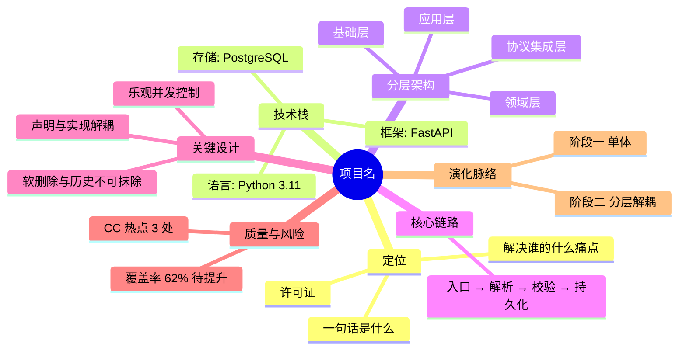

# 思维导图产物规范（Mind Map Spec）

> 目标：让人 3 分钟看懂一个陌生项目。思维导图是**总览层**产物，不是报告的替代品——它只放"骨架"，不放论证。

## 1. 产物形态

| 文件 | 内容 | 用途 |
|------|------|------|
| `analysis/<项目>项目全景思维导图.md` | ① Mermaid `mindmap` 源码 ② 纯缩进树（无渲染器也能读） ③ 内联 SVG 的 HTML 片段 ④ 一句话导读 | 给用户直接看，也可粘到别处 |
| 各 HTML 报告内的 `#mindmap` 区块 | 与 md 同源的**内联 SVG**（禁 CDN） | 报告内可折叠的导图区 |

## 2. Mermaid 写法（md 内）

````markdown

````

**Mermaid 语法硬约束**（否则渲染失败）：

1. 节点文本 ≤ 14 个汉字；超长就拆成子节点。
2. 节点文本内**禁止**出现 `(` `)` `[` `]` `{` `}` `:` `;` 与原义冲突的字符；需要时用中文括号「」或不写。
3. 根节点才用 `root((...))`，其余用纯文本缩进。
4. 缩进必须是空格，层级递进保持一致（建议 2 空格/层）。
5. 不在同一份导图里混用 `mindmap` 与 `graph` 语法。

## 3. 纯缩进树（兜底，必备）

任何平台都能看懂的形态，与 Mermaid 内容同源：

```
项目名
├── 定位
│   ├── 一句话是什么
│   └── 解决谁的什么痛点
├── 技术栈
│   ├── 语言：Python 3.11
│   └── 存储：PostgreSQL
└── 分层架构
    ├── 基础层
    └── 领域层
```

## 4. HTML 内联 SVG 画法（零依赖）

要求：单个 `<svg>`，`viewBox="0 0 680 <height>"`，全部颜色内联（不引外部 CSS/JS/CDN），浅色底 + 深色字（跟随报告主题）。

**布局算法（左右树，简单可靠）**：

1. 根节点居中，`x = 340`，`y = 40`。
2. 一级分支按数量分左右两组（左半、右半），纵向等距分布。
3. 每个一级节点的子节点在其右侧（或左侧）纵向排开，行距 26px。
4. 连接线用 `<path d="M x1 y1 C ...">` 三次贝塞尔曲线（水平出线、水平入线，观感最稳）。
5. 节点用 `<rect rx="6">` + `<text>`；一级节点填充主色（如 `#1f6f54`）配白字，二级节点白底 + 灰色描边 + 深字。
6. 画完统计最大 y，回填 `viewBox` 高度并使 `height` 自适应。

**结构顺序固定**（方便横向对比不同项目）：

```
定位 → 技术栈 → 分层架构 → 核心链路 → 关键设计 → 质量与风险 → 演化脉络
```

## 5. 内容来源约束

导图每个节点都必须**在报告里有出处**：

- 技术栈节点 → 来自技术栈拆解报告
- 质量与风险节点 → 来自代码质量评估报告（带数字）
- 关键设计节点 → 来自设计巧思分析（只取最亮的 3–5 项）
- 演化脉络节点 → 来自演化分析的时间线阶段名

不允许在导图里出现报告中没有的结论。导图是"索引"，不是"新证据"。

## 6. 自检清单（交付前逐项打勾）

- [ ] Mermaid 源码里没有 `(`/`)`/`:` 等冲突字符（根节点除外）
- [ ] 节点文本均 ≤ 14 字
- [ ] 层级深度 ≤ 4（再深就该进报告了）
- [ ] 一级分支 ≤ 7 个
- [ ] 纯缩进树与 Mermaid 内容一致
- [ ] HTML 内联 SVG 无任何外部引用（`grep -E "https?://(?!www\.w3\.org)" ` 无命中）
- [ ] SVG 的 `viewBox` 高度 ≥ 实际内容最大 y + 20
- [ ] 每个节点都能在报告中找到出处
